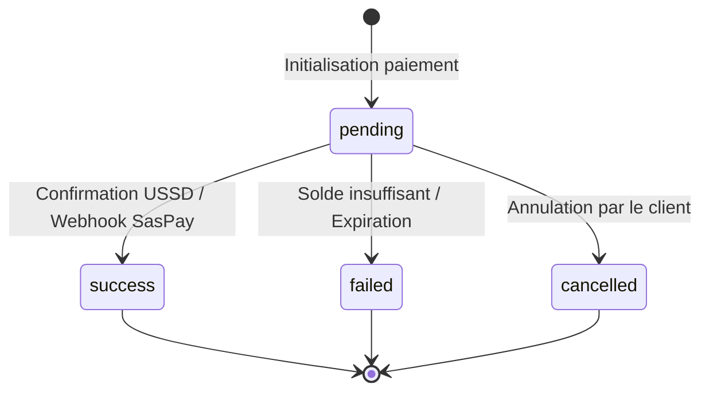

# Modèle de Données & Concepts Clés

L'architecture PichFlow repose sur plusieurs entités clés garantissant l'isolation des données marchands et la conformité avec la spécification officielle SasPay.

---

## 1. Application (`applications`)

Une application représente une boutique, un service ou une entité métier spécifique au sein de votre compte. 
- Les clés API, webhooks, transactions, clients et liens de paiement sont strictement cloisonnés par `application_id`.
- Un marchand peut gérer plusieurs applications (ex: "Boutique Cotonou", "Plateforme SaaS Abidjan").

---

## 2. Transaction (`transactions`)

Représente une opération de paiement entrant (Pay-in).

| Champ | Type | Description |
| :--- | :--- | :--- |
| `id` | `string` | Identifiant interne unique PichFlow (ex: `tx_1728945600000`). |
| `reference` | `string` | Référence métier unique de la commande (ex: `TX-PF-891234`). |
| `external_id` / `saspay_id` | `string` | Identifiant officiel renvoyé par la passerelle SasPay. |
| `amount` | `number` | Montant total débité au client. |
| `currency` | `string` | Code devise ISO (ex: `XOF`). |
| `status` | `string` | État : `pending`, `success`, `failed`, `cancelled`. |
| `customer_name` | `string` | Nom du client payeur. |
| `customer_email` | `string` | Adresse email du client pour l'envoi de la facture. |
| `customer_phone` | `string` | Numéro de téléphone au format international. |
| `net_amount` | `number` | Montant net crédité sur votre wallet après déduction des frais. |
| `platform_fee` | `number` | Frais de la plateforme PichFlow. |
| `provider_fee` | `number` | Frais facturés par la passerelle SasPay / opérateur. |

---

## 3. Client (`customers`)

PichFlow gère automatiquement un carnet d'adresses clients étanche par marchand et par application :
- Lorsqu'une transaction réussit, PichFlow met à jour la fiche client correspondante ou en crée une nouvelle si l'adresse email n'existait pas.
- Champs enregistrés : `name`, `email`, `phone`, `country`, `payment_count`, `total_spent`, `last_transaction_at`.
- Aucune fuite d'information client entre marchands ou entre applications d'un même compte.

---

## 4. Wallet (`wallets`)

Chaque marchand dispose de portefeuilles électroniques multi-devises (`XOF`, etc.) enregistrant son solde disponible en temps réel.
- **Crédit automatique** : Lorsqu'un paiement est confirmé par SasPay, le montant net est immédiatement crédité sur le wallet correspondant.
- **Débit sur retrait** : Une demande de payout déduit instantanément le solde du wallet.
- **Transfert inter-wallets** : Possibilité de transférer des fonds d'un wallet à un autre avec application des taux de change officiels.

