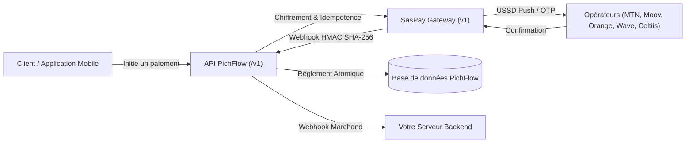

# Bienvenue sur la Documentation Développeur PichFlow

**PichFlow** est une infrastructure moderne d'encaissement et de décaissement (Pay-in & Pay-out) conçue pour permettre aux marchands, plateformes e-commerce et applications SaaS d'accepter les paiements Mobile Money et cartes bancaires à travers toute la zone UEMOA et CEMAC.

Propulsée par une intégration robuste et certifiée avec la passerelle **SasPay** (`https://api.saspay.me/api/v1`), PichFlow élimine la complexité technique liée aux multiples intégrations d'opérateurs télécoms et banques partenaires.

<CardGroup cols={2}>
  <Card title="Démarrage rapide" icon="bolt" href="/quickstart">
    Intégrez votre premier paiement Mobile Money en moins de 10 minutes.
  </Card>
  <Card title="Clés API & Environnements" icon="key" href="/authentication">
    Comprenez le fonctionnement de vos clés Sandbox (`sk_test_`) et Live (`sk_live_`).
  </Card>
  <Card title="Checkout Hébergé" icon="browser" href="/hosted-checkout">
    Redirigez vos clients vers une page de paiement prête à l'emploi et sécurisée.
  </Card>
  <Card title="Softpay & OTP Direct" icon="mobile" href="/softpay-otp">
    Déclenchez directement un push USSD sur le téléphone de vos utilisateurs.
  </Card>
</CardGroup>

---

## Architecture de la Plateforme

PichFlow s'articule autour de modules interconnectés garantissant la traçabilité financière, l'étanchéité des données et une disponibilité maximale :

---

## Pourquoi choisir PichFlow ?

| Fonctionnalité | Avantage PichFlow |
| :--- | :--- |
| **Génération Duale de Clés** | Deux clés (`sk_test_` et `sk_live_`) générées simultanément sans risque de confusion. |
| **Paiements Idempotents** | En-tête `Idempotency-Key` pris en charge sur tous les flux financiers pour prévenir les doubles débits. |
| **Multi-Opérateurs Dynamique** | MTN Bénin, Moov Bénin, Celtiis Cash, Wave CI/SN, Orange Money, Free SN, Cartes Visa/Mastercard. |
| **Webhooks Signés HMAC SHA-256** | Validation cryptographique avec vérification de l'horodatage contre les attaques par rejeu (300s). |
| **Auto-Population Clients** | Création et mise à jour automatique des fiches clients lors de chaque paiement validé. |
| **Gestion Multi-Wallets** | Soldes séparés par devise (`XOF`, etc.) et transferts de solde instantanés. |

