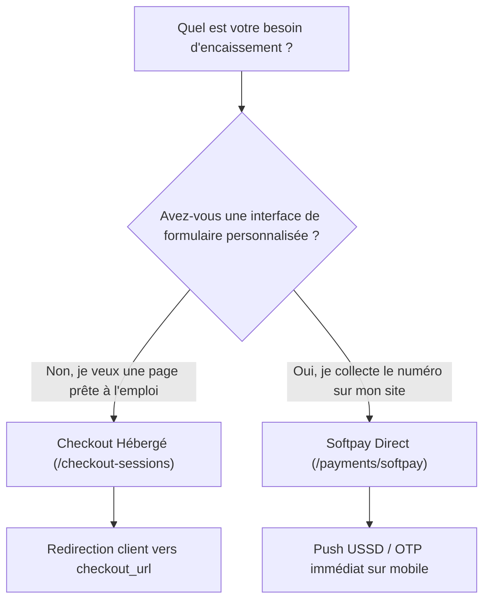

# Guide d'Intégration des Paiements

PichFlow offre deux modes d'encaissement principaux pour s'adapter à l'architecture de votre application :

---

## Comparatif des Solutions

| Critère | Checkout Hébergé | Softpay Direct |
| :--- | :--- | :--- |
| **Endpoint API** | `POST /v1/checkout-sessions` | `POST /v1/payments/softpay` |
| **Effort de développement** | Minimal (quelques lignes de code) | Moyen (formulaire personnalisé requis) |
| **Expérience utilisateur** | Redirection vers la page de paiement sécurisée PichFlow / SasPay | L'utilisateur reste dans votre application |
| **Moyens supportés** | Tous les moyens disponibles du pays sélectionné | Mobile Money direct, Wave, Cartes bancaires |
| **Idempotency-Key** | Non requis selon spécification | **Obligatoire** (`Idempotency-Key: <UUID>`) |
| **Cas d'usage recommandés** | E-commerce standard, abonnements SaaS, factures ponctuelles | Applications mobiles natives, bornes de commande, tunnels de vente sur-mesure |

---

## Règles Fondamentales de Gestion des Montants

1. **Formatage décimal chaîne** : Selon la spécification officielle SasPay, tous les montants transmis dans les payloads doivent être des chaînes avec exactement deux décimales (ex: `"15000.00"`, `"250.50"`). Les flottants JavaScript bruts sont strictement déconseillés afin d'éviter les erreurs d'arrondi.
2. **Gestion des frais (`fee_charge_mode`)** :
   - `ADD_ON` : Les frais de passerelle sont ajoutés en supplément au total à payer par le client final.
   - `DEDUCTED` : Les frais de passerelle sont absorbés par le marchand et déduits du montant net perçu.

