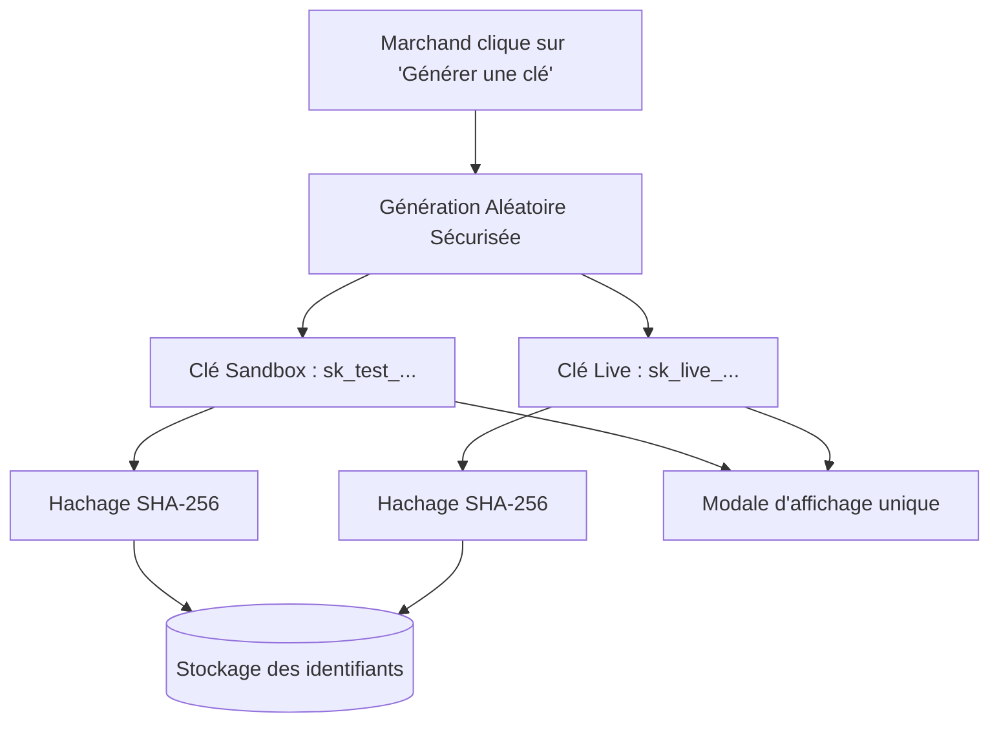

# Authentification & Clés API

Toutes les requêtes vers l'API PichFlow doivent être authentifiées via une clé d'API transmise dans l'en-tête standard HTTP `Authorization`.

```http
Authorization: Bearer <PICHFLOW_API_KEY>
```
ou pour la production :
```http
Authorization: Bearer <PICHFLOW_API_KEY>
```

---

## Modèle de Clés API Duales

Dans PichFlow, vous n'avez plus à choisir entre Sandbox et Live lors de la création d'une clé d'application. 

Lorsque vous générez une nouvelle clé dans le Dashboard :
1. **Deux clés distinctes** sont générées cryptographiquement à partir d'entropie aléatoire sécurisée :
   - Une clé **Sandbox** au préfixe `sk_test_`.
   - Une clé **Live** au préfixe `sk_live_`.
2. **Stockage** : Le code d'authentification accepte une clé stockée dans `secret_key` ou son hash SHA-256 dans `secret_hash`. La documentation source ne permet donc pas d'affirmer que seul le hash est conservé.
3. **Affichage unique** : Les secrets complets vous sont présentés une seule et unique fois dans la modale de création. Ensuite, ils sont masqués (`sk_test_...abc12`).



---

## Environnements & Étanchéité

| Environnement | Préfixe Clé | Comportement & Passerelle SasPay |
| :--- | :--- | :--- |
| **Sandbox (Test)** | `sk_test_...` | Les paiements n'entraînent **aucun débit financier réel**. Utilisé pour le développement et la validation de vos webhooks. |
| **Live (Production)** | `sk_live_...` | Les paiements déclenchent des **débits et crédits réels** sur les comptes Mobile Money et bancaires. |

> Le serveur associe chaque clé à un environnement. Le domaine public propre à Sandbox et les garanties de simulation ne sont pas établis par les fichiers audités : vérifiez ces paramètres dans le tableau de bord avant tout test financier.

---

## Bonnes Pratiques de Sécurité

1. **Ne jamais exposer les clés secrètes côté client** : N'utilisez jamais vos clés `sk_test_` ou `sk_live_` dans une application React, Vue, mobile iOS/Android ou dans une variable publique `NEXT_PUBLIC_*`.
2. **Rotation des clés** : En cas de fuite de secret suspectée, rendez-vous immédiatement dans le Dashboard pour **révoquer** la clé concernée et en générer une nouvelle.
3. **Idempotence systématique** : Spécifiez toujours l'en-tête `Idempotency-Key` sur les appels de création de paiement ou de virement pour éviter tout double traitement lors des réessais réseau.
