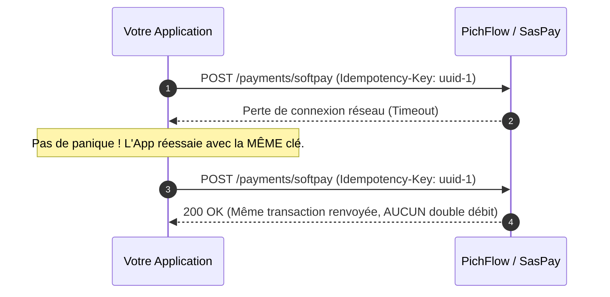

# Gestion des Erreurs & Codes HTTP

PichFlow et SasPay utilisent des codes de statut HTTP conventionnels pour indiquer la réussite ou l'échec des requêtes API.

---

## 1. Codes de Statut HTTP

Les codes ci-dessous sont des références générales mentionnées dans les pages existantes ; la spécification OpenAPI ne définit pas les réponses de toutes les routes. Consultez la référence de chaque opération avant de dépendre d'un code précis.

| Code HTTP | Définition | Contexte fréquent |
| :--- | :--- | :--- |
| `200 OK` | Succès | Requête exécutée normalement. |
| `201 Created` | Ressource créée | Le code de réponse exact dépend de l'opération. |
| `400 Bad Request` | Requête invalide | Paramètre manquant, montant négatif, format de numéro invalide. |
| `401 Unauthorized` | Non authentifié | Clé API absente ou préfixe non reconnu. |
| `403 Forbidden` | Accès refusé | Clé révoquée, scope insuffisant ou **IP non déclarée dans la whitelist SasPay** (payouts). |
| `404 Not Found` | Ressource introuvable | Transaction, session ou lien de paiement inexistant. |
| `409 Conflict` | Conflit / Doublon | Réutilisation d'une clé d'idempotence avec un payload différent. |
| `410 Gone` | Ressource expirée | Session de paiement arrivée à échéance. |
| `422 Unprocessable Entity` | Erreur métier opérateur | Numéro de téléphone non éligible à la réception de Mobile Money. |
| `429 Too Many Requests` | Limite de débit atteinte | Trop d'appels simultanés sur un court intervalle (ralentissez le polling). |
| `500 Internal Server Error` | Erreur interne | Erreur inattendue côté serveur ou indisponibilité temporaire. |

---

## 2. Codes d'Erreurs Métier SasPay Fréquents

| Code Erreur | Message Typique | Résolution Recommandée |
| :--- | :--- | :--- |
| `ip_not_whitelisted` | "Client IP is not whitelisted for payout" | Déclarez l'adresse IP publique de votre serveur dans le Dashboard SasPay. |
| `invalid_amount` | "Amount must be a decimal string formatted as 0.00" | Utilisez une chaîne avec 2 décimales (ex: `"5000.00"`). |
| `insufficient_balance` | "Wallet balance insufficient" | Approvisionnez votre compte ou attendez l'encaissement de paiements. |
| `network_unavailable` | "Provider network temporary maintenance" | Affichez un message invitant le client à choisir un autre réseau. |
| `otp_required` | "Customer OTP confirmation required" | Demandez au client le code OTP reçu par SMS et soumettez-le via `/confirm-otp`. |

---

## 3. Règle d'Or de l'Idempotence (`Idempotency-Key`)

L'idempotence garantit qu'une requête exécutée plusieurs fois avec la même clé produit exactement le même effet qu'un appel unique.

- **Même intention** : Réutilisez toujours la même `Idempotency-Key` lors d'un réessai suite à une coupure réseau.
- **Nouvelle intention** : Générez toujours une nouvelle `Idempotency-Key` (UUID v4) pour une nouvelle commande ou un nouveau panier.
